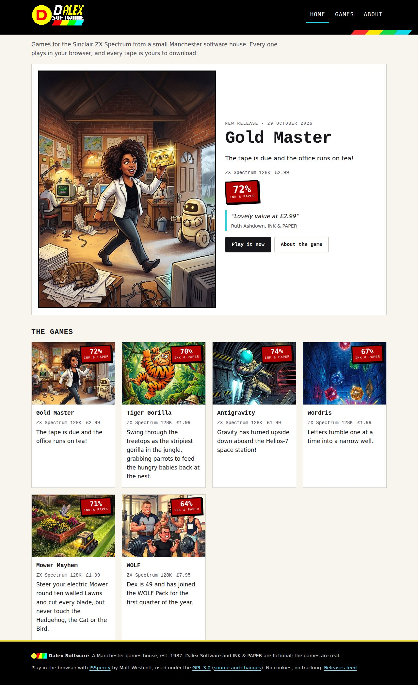

# Dalex Software website

The website of Dalex Software, a fictional 1987 Manchester software house, and its ZX Spectrum games.

[](https://github.com/danielvaughan/dalex-software/actions/workflows/pages.yml)
[](https://dalex-software.co.uk/)


<p align="center"></p>

- [What it is](#what-it-is)
- [How to run](#how-to-run)
- [Show or hide a game](#show-or-hide-a-game)
- [Publish or update a game](#publish-or-update-a-game)
- [Checks and deploy](#checks-and-deploy)
- [Project structure](#project-structure)
- [Documentation](#documentation)
- [Related repositories](#related-repositories)
- [Issues](#issues)
- [Licence and credits](#licence-and-credits)

## What it is

The official site of the games: <https://dalex-software.co.uk/>. Every game page plays a free demo in the
browser (JSSpeccy, click to play) or says "Demo coming soon", and shows the controls, screen shots and the
INK & PAPER scores and quote. A Studio page shows how the studio works.

Nothing is downloadable and no price is shown: the full tapes stay in the games' private repositories, and
prices are "to be confirmed" ([D-16 to D-19](docs/decisions.md)). Game pages are written by the toolkit's
`zx-website` skill from each game's media kit; this repository is the only public one.

The CI badge is GitHub's own status image for the build-and-deploy workflow on `main`.

| | |
| --- | --- |
| **See it** | [dalex-software.co.uk](https://dalex-software.co.uk/) · [the Studio](https://dalex-software.co.uk/studio/) |
| **Run it** | `python3 build.py`, then serve `_site/` ([How to run](#how-to-run)) |
| **Checks** | [Workflow runs](https://github.com/danielvaughan/dalex-software/actions/workflows/pages.yml): build, the `tests/` suite, then deploy to GitHub Pages |
| **Decisions** | [docs/decisions.md](docs/decisions.md) |
| **Work** | [Open issues](https://github.com/danielvaughan/dalex-software/issues) |

## How to run

### Quick start

```sh
python3 build.py && python3 -m unittest discover -s tests
python3 -m http.server -d _site 8000   # then open http://localhost:8000/
```

The generator needs only Python 3's standard library. The player needs the site served over HTTP; opening
the files directly cannot fetch the demo.

## Show or hide a game

Edit `site.json`. Each game has an entry:

```json
{ "slug": "gold-master", "visible": true, "order": 1, "featured": true,
  "demo": { "milestone": 1, "sha256": "f63311ea…", "contains": "Level 1 of 4: …" } }
```

- `visible`: `false` hides the game everywhere. Its pages, sitemap and feed entries are not built and
  none of its files are deployed; its folder stays in `games/` so it can be shown again.
- `order`: position on the home page and games list (lowest first).
- `featured`: the game in the home page hero. At most one visible game may be featured; with none,
  the first visible game is used.
- `demo`: the demo tape the page plays (its milestone, sha256 and a line saying what it contains), or `null`
  for "Demo coming soon". The publisher writes it; the build checks `games/<slug>/demo.bin` decodes to that sha256.
  Change the demo by publishing again with `--demo` rather than editing the sha256 by hand. Editing only
  `contains` is fine.
- `touch`: the on-screen pad for phones and tablets, `{"dpad": {"up": "Q", ...}, "diagonals": false,
  "buttons": [{"keys": "SPACE", "label": "Fire"}, ...]}`. Every key must be in the game's own controls list (the
  build refuses others); the first button is the big start/fire button ([D-22](docs/decisions.md)).
- Optional `blurb` replaces the game's own blurb on the site. There is no price setting: no price is shown.

Commit and push to `main`; the workflow rebuilds and deploys the site.

## Publish or update a game

At the end of production, after the media kit passes, run the toolkit's `zx-website` skill from the
game's repository (`plugins/zx-media-kit/skills/zx-website/` in `spectrum-game-reference`):

```sh
python3 <zx-media-kit>/scripts/publish_site.py <game repo> [--site ../dalex-software] [--dry-run]
```

It refuses a kit that is stale against the release tape, picks the demo (`--demo <tape|milestone|none>`,
else `site.json`'s `demo`, else the game's gated first milestone), refuses the release tape as a demo,
writes `games/<slug>/` with the demo obfuscated as `demo.bin` and every price sentence cut, adds a new
game to `site.json` (shown, last in order) or keeps an existing entry's settings, runs the build and
tests, commits and pushes. Do not edit `games/<slug>/` by hand: the next publish replaces it.

## Checks and deploy

- [`.github/workflows/pages.yml`](.github/workflows/pages.yml) builds the site, runs
  `python3 -m unittest discover -s tests`, and on every push to `main` deploys `_site/` with the official
  GitHub Pages actions. Pull requests are built and tested but not deployed.
- The custom domain is `dalex-software.co.uk` ([`CNAME`](CNAME)); the DNS records the domain needs are in
  [docs/DNS.md](docs/DNS.md).
- Commit hooks ([`.pre-commit-config.yaml`](.pre-commit-config.yaml)): Gitleaks, markdownlint, zizmor and
  actionlint. Install them with `pre-commit install`.

## Project structure

| Path | Contents |
| --- | --- |
| [`site.json`](site.json) | site settings and the list of games: which are shown, in what order, which is featured |
| [`games/`](games/) | one folder per game, written by the toolkit's `zx-website` skill: `game.json`, `demo.bin` (the obfuscated demo tape, when there is a demo), cover, screen shots and any licences |
| [`content/`](content/) | the About and Studio page bodies |
| [`static/`](static/) | CSS, the player script (which holds the demo key), the Dalex logo, people sprites, favicons, the studio film and the vendored JSSpeccy 3.2 |
| [`assets/source/`](assets/source/) | source sheets for the About page's people, cut by [`tools/people.py`](tools/people.py) |
| [`build.py`](build.py) | the generator (Python 3 standard library only) that writes `_site/` |
| [`tests/`](tests/) | build checks run in CI before every deploy |
| [`docs/`](docs/) | [decisions](docs/decisions.md), [DNS records](docs/DNS.md) and screenshots |

## Documentation

- [Decisions](docs/decisions.md) and [DNS records](docs/DNS.md)
- Screenshots: [home](docs/screenshots/home.jpg), [home on a phone](docs/screenshots/home-mobile.jpg),
  [a game page](docs/screenshots/game-gold-master.jpg) and the player running
  [Gold Master](docs/screenshots/play-gold-master.jpg) and [Wordris](docs/screenshots/play-wordris.jpg),
  captured from the first deploy. The demos at their title screens, captured after the switch to demos:
  [Gold Master](docs/screenshots/demo-gold-master.png), [Antigravity](docs/screenshots/demo-antigravity.png),
  [WOLF](docs/screenshots/demo-wolf.png) and [Wordris](docs/screenshots/demo-wordris.png), and a page with
  no demo yet, [Tiger Gorilla](docs/screenshots/no-demo-tiger-gorilla.png). The [playtest of 2026-10-29](docs/playtest-2026-10-29.md) (keys, touch pad, phone layout) has its
  screenshots in [docs/screenshots/playtest/](docs/screenshots/playtest/).

## Related repositories

These are private:

- The games: [zx-gold-master](https://github.com/danielvaughan/zx-gold-master),
  [zx-antigravity](https://github.com/danielvaughan/zx-antigravity),
  [zx-mower-mayhem](https://github.com/danielvaughan/zx-mower-mayhem),
  [zx-tiger-gorilla](https://github.com/danielvaughan/zx-tiger-gorilla),
  [zx-wolf](https://github.com/danielvaughan/zx-wolf), [zx-wordris](https://github.com/danielvaughan/zx-wordris)
- [spectrum-game-reference](https://github.com/danielvaughan/spectrum-game-reference): the toolkit, whose
  `zx-website` skill publishes the game pages
- [dalex-studio](https://github.com/danielvaughan/dalex-studio): the Studio
- [zx-plugins](https://github.com/danielvaughan/zx-plugins) and
  [zx-game-template](https://github.com/danielvaughan/zx-game-template): the released plugins and the
  starting point for a new game

## Issues

Report site problems in [this repository's issues](https://github.com/danielvaughan/dalex-software/issues).
A wrong game page is fixed in the game's media kit and published again, not edited here.

## Licence and credits

There is no licence file; all rights reserved.

- Dalex Software and the INK & PAPER magazine are fictional.
- JSSpeccy 3.2 by Matt Westcott is vendored under GPL-3.0, with its complete source and local patches:
  see [`static/jsspeccy/README.md`](static/jsspeccy/README.md).
- A game's third-party licences (for example Wordris's CC0 word list) are published in its `games/<slug>/`
  folder.
